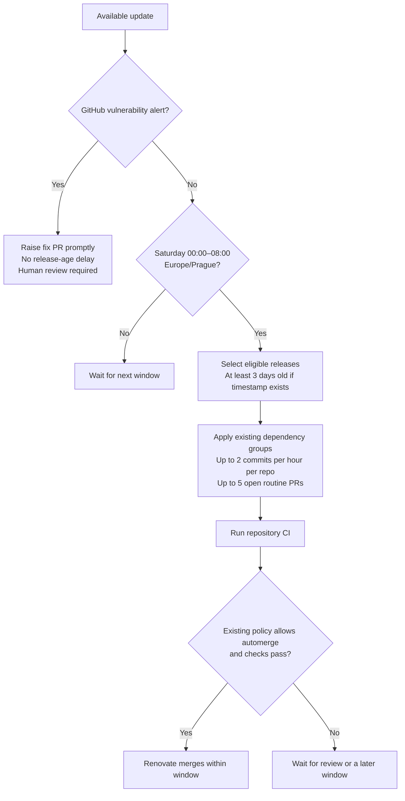
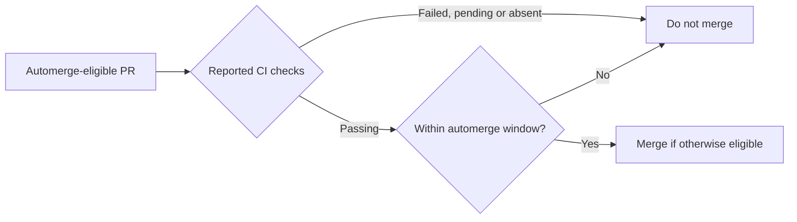

# ArkanisCorporation/renovate-config

Shared [Renovate](https://docs.renovatebot.com/) preset for all Arkanis Corporation repositories.

## Usage

Add one line to your repo's `renovate.jsonc`:

```jsonc
{
    "$schema": "https://docs.renovatebot.com/renovate-schema.json",
    "extends": [
        "github>ArkanisCorporation/renovate-config"
    ],
    "reviewers": [
        "team:your-team-here"
    ]
}
```

That's it. All grouping rules, automerge policy, lockFileMaintenance, and custom managers are inherited. Updates to this preset roll out automatically on the next Renovate run — no PR required in consumer repos.

## Sustainable update cadence

Routine branch creation, automatic branch updates and Renovate automerges run weekly on **Saturday, 00:00–08:00 Europe/Prague**.
The timezone follows CET/CEST automatically.
The conservative preset inherits the same schedule and continues to disable automerge.



| Control | Shared default | Purpose |
|---|---|---|
| `schedule` | `* 0-7 * * 6` | Batch routine updates weekly and avoid EU working hours |
| `updateNotScheduled` | `false` | Prevent automatic branch refreshes outside the window |
| `automergeSchedule` | Same Saturday window | Keep Renovate merges within the window too |
| `platformAutomerge` | `false` | Let Renovate enforce merge timing; GitHub-native automerge ignores this schedule |
| `commitHourlyLimit` | `2` per repository | Limit new-branch and automatic-rebase commits that trigger CI |
| `prHourlyLimit` / `prConcurrentLimit` | `2` / `5` per repository | Bound PR arrival rate and open routine work |
| `minimumReleaseAge` | `3 days` | Allow newly published versions to settle before selection |
| `minimumReleaseAgeBehaviour` | `timestamp-optional` | Keep registries without release timestamps from becoming permanently blocked |
| `internalChecksFilter` | `strict` | Filter versions still pending the release-age check |
| `rebaseWhen` | `auto` | Keep automerge/up-to-date requirements compatible; scheduling and commit limits contain rebase work |
| `lockFileMaintenance.schedule` | `* 0-7 1-7 * 6` | Refresh lock files only on the first Saturday each month |
| `vulnerabilityAlerts` | Enabled, immediate eligibility, no age delay, manual merge | Keep supported GitHub vulnerability fixes outside the routine queue |

### Why weekly Saturday overnight?

| Cadence | Benefit | Tradeoff |
|---|---|---|
| Every weekday overnight | Small, frequent updates; next morning has staff available | Still repeats patch updates and CI runs throughout the week |
| Friday night / Saturday morning (chosen) | Weekly batching, low developer CI contention, long gap before Monday | Deploy-on-merge repositories may need weekend incident coverage |
| First and third Saturday | Fewer update windows and more skipped intermediate patches | Larger batches, longer routine delays, and a possible three-week gap |
| Entire weekend | More time to clear a large queue | More opportunities for repeated updates within the same weekend |

Weekly batching is the starting compromise between CI churn, review size and freshness.
Keep the existing ecosystem groups and dependency-specific groups; avoid combining unrelated production operators into one large patch PR solely to save CI.
The three-day release-age check is a settling period, not a batching mechanism: it applies to each version independently.
The schedule does not guarantee exactly one update per dependency per week; an eligible newer release can still arrive within the eight-hour window.

### Boundaries and rollout

These settings gate Renovate actions, not the CI scheduler or production deployment windows.
Jobs started before 08:00 can continue afterwards; human merges, manual rebase requests, security fixes and other automation can still trigger weekday CI.
The hosted bot must actually visit the repository during the window; a schedule does not arrange a bot run or guarantee an automerge before the window closes.
An eligible PR that misses the merge window waits for the next one.

GitHub vulnerability-fix PRs bypass routine scheduling and rate limits, with release-age and dashboard approval delays removed explicitly here.
They require human review and are only available where GitHub alerts, Renovate permissions and the dependency ecosystem support detection and remediation; this is not a scanner for every container or Helm vulnerability.
The conservative preset keeps all automerge disabled, and existing consumer-specific safety rules still apply.

All limits are per repository, so many repositories can still contend for shared runners at once.
For strict fleet-wide CI capacity, also use runner capacity controls or stagger repository windows.
Review queue depth, dependency CI runs, rebases and security-fix latency after four weekly windows; adjust limits or split windows if the backlog grows.

The shared preset is overridable configuration, not an organization enforcement boundary.
Consumer `schedule`, `packageRules`, manager settings or lock-file schedules can override it; audit exceptions before treating the organization as fully scheduled.
Changes take effect for consumers of the default branch on their next Renovate run, while SHA/tag-pinned consumers require a preset-ref update.

To opt a repository into first-and-third-Saturday routine updates, override both action windows:

```jsonc
{
    "schedule": ["* 0-7 1-7,15-21 * 6"],
    "automergeSchedule": ["* 0-7 1-7,15-21 * 6"]
}
```

Renovate combines restricted day-of-month and day-of-week fields with AND, so this selects the first and third Saturday, not every Saturday plus those dates.
Monthly lock-file maintenance remains on the first Saturday.

References: [scheduling](https://docs.renovatebot.com/key-concepts/scheduling/), [automerge timing](https://docs.renovatebot.com/configuration-options/#automergeschedule), [commit limits](https://docs.renovatebot.com/configuration-options/#commithourlylimit), [release age](https://docs.renovatebot.com/key-concepts/minimum-release-age/), [vulnerability alerts](https://docs.renovatebot.com/configuration-options/#vulnerabilityalerts).

---

## CI checks and private repositories

The default preset uses **Renovate-managed PR automerge**, with `platformAutomerge: false`, `automergeType: "pr"` and `ignoreTests: false`.
Renovate checks CI results itself and does not merge when checks are failing, pending, or absent, including on free private repositories without enforced branch protection.
`internalChecksAsSuccess: false` prevents Renovate's own stability/confidence checks from standing in for repository CI.



This differs from GitHub-native automerge (`platformAutomerge: true`), which depends on GitHub's enforced required-check rules and cannot honor Renovate's `automergeSchedule`.
Without required checks, platform-native automerge may merge before CI starts or despite failures.
The previous version of this README incorrectly applied that caveat to all Renovate automerge; it applies to the platform-native mode.

The preset controls Renovate's behavior, not GitHub permissions or other merge actors.
It does not enforce human approvals where GitHub itself does not enforce them, and it cannot identify an expected workflow that never reports a result.
Ensure CI triggers for Renovate PRs and reports a reliable aggregate pass/fail result; use the conservative preset where every merge needs human judgment.

References: [Renovate checks before automerge](https://docs.renovatebot.com/configuration-options/#ignoretests), [absence of tests](https://docs.renovatebot.com/key-concepts/automerge/#absence-of-tests), [platform-native caveat](https://docs.renovatebot.com/configuration-options/#platformautomerge).

### Conservative preset

Inherits grouping, scheduling, lockFileMaintenance, labels and custom managers from the default preset.
Disables all Renovate automerge so a human must merge every PR.

```jsonc
{
    "$schema": "https://docs.renovatebot.com/renovate-schema.json",
    "extends": [
        "github>ArkanisCorporation/renovate-config:conservative"
    ],
    "reviewers": [
        "team:your-team-here"
    ]
}
```

---

## ⚠️ Behavior change from old per-repo configs

If your repo previously had its own `renovate.json` with automerge enabled for minor/patch updates, **two things now work differently**:

### 1. NuGet (.NET) updates: grouped PR, manual review required

**Before:** each package update got its own PR and automerged on minor/patch.

**After:** all NuGet minor/patch updates are batched into a single **".NET dependencies and tools"** PR. This PR requires manual approval — it does **not** automerge.

**Why:** a grouped PR lets you assess the full picture before merging. The volume is manageable in one review, and it's worth a human glance before dependencies shift.

**To restore automerge** (the group remains; the PR just merges automatically once all checks pass), add to your `renovate.jsonc`:

```jsonc
"packageRules": [
    { "matchManagers": ["nuget"], "automerge": true },
]
```

### 2. GitHub Actions updates: grouped PR, manual review required

Same deal. All GitHub Actions minor/patch/digest updates batch into a single **"GitHub Actions"** PR requiring approval.

**To restore automerge:**

```jsonc
"packageRules": [
    { "matchManagers": ["github-actions"], "automerge": true },
]
```

> Both opt-out lines are already present as commented-out blocks in `example-consumer.jsonc` — copy that file as your starting point so you have them right where you need them.

---

## What the preset includes

| Rule | Behavior |
|------|----------|
| `extends: config:recommended` | Renovate defaults + dependency dashboard |
| `labels: ["automated"]` | tag on all Renovate PRs |
| `lockFileMaintenance` | first-Saturday monthly lock-file refresh PR |
| Routine scheduling | Saturday 00:00–08:00 Europe/Prague, including branch updates and Renovate automerges |
| CI churn controls | 2 commits/hour and 5 concurrent routine PRs per repo; 3-day release settling period where timestamps exist |
| Vulnerability alerts | immediate eligibility, manual merge |
| minor/patch/pin/digest | automerge (overridden for groups below) |
| **GitHub Actions** | grouped, manual review |
| GitHub Actions SHA pinning | third-party `uses:` pinned to commit SHA + exact version comment; `ArkanisCorporation/**` excluded |
| **.NET / NuGet** | grouped, manual review |
| semantic-release toolchain | grouped, manual review |
| Kubernetes tools (kubectl, helm) | grouped, manual review |
| major | never automerge |
| custom managers | tracks `semantic_version`, `kubectl_version`, `helm_version` pins in workflow YAML, plus Docker tags in static Aspire AppHost declarations |

### GitHub Actions SHA pinning

Third-party actions and reusable workflows are pinned to full commit SHAs, so a moved or compromised upstream tag can't change what runs without a reviewed PR:

```yaml
# before
- uses: actions/checkout@v7
# after Renovate's pin PR
- uses: actions/checkout@3d3c42e5aac5ba805825da76410c181273ba90b1 # v7.0.1
```

This matches Renovate's `helpers:pinGitHubActionDigestsToSemver`. The preset inlines it so it can exclude `ArkanisCorporation/**`. Our own `ci` repo is consumed via the floating `@v1` tag on purpose: moving that tag is how CI changes roll out across the org.

**Effect on existing repos:** on its next run, Renovate adds the tag → SHA conversion to the grouped **"GitHub Actions"** PR (manual review, even on the default preset). After that, pins are kept current through the same grouped PR.

### Aspire container image tags

The preset detects Docker image tags in static string-literal `AppHost.cs` container references.
It supports these forms:

```csharp
builder.AddContainer("authentik", "ghcr.io/goauthentik/server", "2026.8.3");

resource.WithImage("ghcr.io/goauthentik/server", "2026.8.3");

resource
    .WithImage("ghcr.io/goauthentik/server")
    .WithImageTag("2026.8.3");
```

For the last form, `WithImage` must precede `WithImageTag` in the same fluent expression, with no semicolon between them.
Intervening fluent calls and line breaks are supported.
Comments between the tagless `WithImage` call and `WithImageTag` are not supported.
Renovate updates only the tag and leaves the image repository unchanged.
Dynamic image names or tags are intentionally excluded because Renovate cannot resolve their values reliably.
The matcher is text-based, so matching examples in comments are also candidates for updates.
Keep commented container examples current, or rewrite them so they do not match one of the supported forms.
The conservative preset inherits this manager automatically.

---

## Per-repo overrides

All `extends`-based rules can be overridden locally. Examples:

**Add extra label:**
```jsonc
"labels": ["automated", "build/publish"]
```

**Re-enable NuGet automerge:**
```jsonc
"packageRules": [
    { "matchManagers": ["nuget"], "automerge": true },
]
```

**Add a repo-specific package grouping:**
```jsonc
"packageRules": [
    { "matchDepNames": ["MyCompany.Sdk.*"], "groupName": "MyCompany SDK", "automerge": false }
]
```

Per-repo `packageRules` entries are **appended** to the preset's rules. Later rules override earlier ones, so per-repo entries take priority.

---

## Files

- `default.json` — the preset loaded by `github>ArkanisCorporation/renovate-config`
- `conservative.json` — the preset loaded by `github>ArkanisCorporation/renovate-config:conservative`; same as default but all automerge disabled
- `example-consumer.jsonc` — copy this into a consumer repo as `renovate.jsonc` and fill in the team slug

> **Note:** `default.json` uses JSONC (JSON with comments). Renovate's config parser is JSONC-aware and handles this correctly. If a future Renovate version rejects inline comments in preset files, the same documentation lives in this README.
